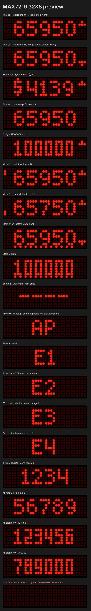

# เครื่องแสดงราคาทองคำไทย — ESP32 + MAX7219 (32×8)

แสดงราคา **ทองคำแท่ง 96.5% (บาทต่อทองหนัก 1 บาท)** บนจอ LED Dot Matrix สีแดง 4-in-1
ดึงข้อมูลเองผ่าน Wi-Fi ทุก ~60 วินาที ไม่ต้องเปิดคอมพิวเตอร์ค้างไว้

ข้อมูล: [thaigoldtoday.com](https://www.thaigoldtoday.com) (อ้างอิงสมาคมค้าทองคำ — เว็บขอให้ระบุที่มาเมื่อนำไปใช้)



## สถานะ

| ส่วน | สถานะ |
|---|---|
| Firmware คอมไพล์สำหรับ ESP32 (`pio run -e esp32dev`) | ✅ ผ่าน |
| Unit tests บน PC (`pio test -e native`) — 69 กรณี | ✅ ผ่าน |
| ตรวจ API จริง (endpoint, JSON schema, HTTPS) | ✅ ตรวจแล้ว 2026-11-05 |
| ตัวจำลองจอ 32×8 | ✅ |
| อัปโหลดเข้า ESP32 จริง / Wi-Fi / TLS บนบอร์ด | ⏳ รอฮาร์ดแวร์ |
| การต่อสาย, ไฟเลี้ยง, การแสดงผลบนจอจริง, ทิศทางภาพ | ⏳ รอฮาร์ดแวร์ |

## โครงสร้าง

```text
gold-led-display/
├── platformio.ini              env: esp32dev (firmware), native (tests)
├── include/gold_config.example.h   ค่าตั้ง (คัดลอกเป็น gold_config.h)
├── lib/GoldCore/src/           logic ที่ไม่ขึ้นกับฮาร์ดแวร์ (ทดสอบบน PC ได้)
│   ├── Font.*                  ฟอนต์ 4×6 และ 3×6
│   ├── DisplayRenderer.*       จัดวางตัวเลขกึ่งกลาง / ตัวบ่งชี้
│   ├── GoldPriceParser.*       แปลง JSON จาก API
│   ├── GoldPriceProvider.h     interface แหล่งข้อมูล (เปลี่ยนแหล่งได้)
│   ├── PriceTracker.*          ความสดของข้อมูล / backoff / ทิศทางราคา
│   ├── Brightness.*            หรี่จอกลางคืน
│   └── ScreenSelector.*        เลือกหน้าจอ (โหมด 0/1/2, ข้อมูลเก่า, AP)
├── src/                        ส่วน ESP32
│   ├── main.cpp
│   ├── GoldPriceClient.*       HTTPS client (WiFiClientSecure + root CA)
│   ├── WifiLink.*              ตั้ง Wi-Fi ผ่านมือถือ + เชื่อมต่อใหม่แบบ backoff
│   ├── LedMatrix.*             ส่งภาพไป MD_MAX72XX
│   ├── PriceStore.*            บันทึกราคาล่าสุดใน NVS
│   └── RootCA.h
├── test/                       Unity tests (display, parser, runtime)
├── tools/preview/              ตัวจำลองจอ 32×8 (ASCII + HTML)
└── docs/WIRING.md              ผังต่อสาย (แบบ 5 เส้น และแบบ HCT125)
```

## เริ่มใช้งาน

1. ติดตั้ง [PlatformIO](https://platformio.org/install) (VS Code extension หรือ `pip install platformio`)
2. ต่อสายตาม [docs/WIRING.md](docs/WIRING.md)
3. อัปโหลดครั้งแรกผ่าน USB-C:
   ```bash
   pio run -e esp32dev -t upload
   ```
4. **ตั้ง Wi-Fi ด้วยมือถือ** (ไม่ต้องแก้โค้ด)
   - จอขึ้น `AP` → เปิด Wi-Fi มือถือ ต่อเข้า **`GoldLED-Setup`** รหัส **`goldprice`**
   - หน้าตั้งค่าจะเด้งขึ้นเอง (ถ้าไม่เด้ง เปิด `http://192.168.4.1`)
   - กด *Configure WiFi* → เลือกชื่อ Wi-Fi บ้าน (2.4 GHz) → ใส่รหัส → Save
   - เครื่องจะจำไว้ ปิดเปิดใหม่ก็ต่อเอง
5. ดู log (ถ้าต้องการ):
   ```bash
   pio device monitor
   ```

ปุ่ม **BOOT** บนบอร์ด:
- **กดสั้น** = เปลี่ยนโหมดแสดงผล 0 → 1 → 2 (จอขึ้น `-0-`/`-1-`/`-2-` แป๊บหนึ่ง, จำค่าไว้)
- **กดค้าง 5 วินาที** = ลืม Wi-Fi เดิม แล้วเปิด `AP` ให้ตั้งใหม่ (เช่น เปลี่ยนเราเตอร์/รหัส)

### อัปเดตโปรแกรมผ่าน Wi-Fi (OTA)

หลังอัปโหลดผ่าน USB ครั้งแรกแล้ว ครั้งต่อไปไม่ต้องเสียบสาย (คอมต้องอยู่ Wi-Fi วงเดียวกัน):

```bash
pio run -e esp32dev_ota -t upload
```

ถ้าหา `gold-led.local` ไม่เจอ (บาง Windows) ให้ใช้ IP ที่เห็นใน log หรือหน้า router:

```bash
pio run -e esp32dev_ota -t upload --upload-port 192.168.1.50
```

### ปรับค่า (ไม่บังคับ)

```bash
cp include/gold_config.example.h include/gold_config.h
```

แก้ค่าใน `include/gold_config.h` แล้วอัปโหลดใหม่ — ไฟล์นี้อยู่ใน `.gitignore`
(ชื่อไม่ใช้ `config.h` เพราะชนกับ header ใน ESP32 SDK)
แนะนำเปลี่ยน `SETUP_AP_PASSWORD` และ `OTA_PASSWORD` (ถ้าเปลี่ยน OTA ต้องแก้ `--auth` ใน `platformio.ini` ด้วย)

## การทดสอบบน PC (ไม่ต้องมีฮาร์ดแวร์)

```bash
pio test -e native
```

ครอบคลุม: ฟอนต์ 0–9 ทั้งสองขนาด, 5/6 หลัก, กึ่งกลาง, ขอบบน/ล่าง 1 แถว, ตรวจ overflow,
JSON ถูก/ผิด/ว่าง, ราคาหาย, HTTP error, timeout, comma ในราคา, schema เปลี่ยน, timestamp เก่า/อนาคต,
Wi-Fi หลุด/กลับมา, API ล่ม, รีสตาร์ทแล้วกู้ราคาเดิม, NTP ไม่ sync, millis() วนรอบ, โหมด 1/2, ลูกศร, ราคาโลก, รูปพรรณ, หรี่กลางคืน

ตัวจำลองจอ (ใช้โค้ดเดียวกับ firmware):

```bash
tools/preview/run.sh                     # ชุดตัวอย่าง -> tools/preview/out/preview.html
tools/preview/run.sh 65950 100000        # ราคาที่ต้องการ
curl -s https://www.thaigoldtoday.com/api/gold-price -o /tmp/g.json && tools/preview/run.sh --json /tmp/g.json
```

## การแสดงผล

ฟอนต์ bitmap ออกแบบเฉพาะ 32×8 ไม่มี comma, ตัวเลขอยู่แถว 1–6 (เว้นแถว 0 และ 7)
เลข `1` แคบกว่าตัวอื่น (3 จุด) เพื่อให้ช่องไฟเท่ากันทุกตัว — ราคาที่มีเลข 1 จะแคบลงเล็กน้อยแต่ยังอยู่กลางจอ

| ราคา | ฟอนต์ | ความกว้าง | ขอบซ้าย/ขวา |
|---|---|---|---|
| 5 หลัก เช่น 65950 | 4×6, เว้น 1 | 24 | 4 / 4 |
| 6 หลัก เช่น 100000 | 3×6, เว้น 1 | 23 | 4 / 5 |

ราคาไทยที่แสดง = **ทองคำแท่ง 96.5%** (ตั้งเป็นทองรูปพรรณได้: `THAI_PRICE_ORNAMENT 1`)

### โหมด (กดปุ่ม BOOT สั้น ๆ เพื่อเปลี่ยน)

| โหมด | แสดง |
|---|---|
| **2 (ค่าเริ่มต้น)** | ราคาขายออกทองไทย **8 วินาที** → ราคาทองโลก `$4139` (USD/ออนซ์) **4 วินาที** |
| 0 | ราคาขายออกทองไทยอย่างเดียว |
| 1 | สลับขายออก / รับซื้อ ทุก 5 วินาที — จุดมุมซ้ายบน = ขายออก, จุดมุมซ้ายล่าง = รับซื้อ |

ราคาโลกขึ้นต้นด้วย `$` ตัวเล็กที่มีขีดตั้งโผล่บน-ล่าง (สูงกว่าตัวเลข 1 จุด) และมีแค่ 4 หลัก จึงแยกจากราคาไทยได้ทันที

### ลูกศรขึ้น/ลง (สามเหลี่ยมเล็กขวาสุด)

- **สามเหลี่ยมมุมขวาบน ▲** = ประกาศรอบล่าสุด **ปรับขึ้น**
- **สามเหลี่ยมมุมขวาล่าง ▼** = ประกาศรอบล่าสุด **ปรับลง**
- ไม่มีสามเหลี่ยม = ราคาไม่เปลี่ยน
- ทองไทย: เทียบกับ **รอบประกาศก่อนหน้า** (จาก `history` ของ API —
  ไม่ใช้ `current.change` เพราะตรวจแล้วเป็นการเปลี่ยนจากเมื่อวาน)
  ถ้า API ไม่มี history เครื่องจะเทียบกับราคาที่เห็นครั้งก่อนเอง
- ทองโลก: เทียบกับราคาปิดวันก่อน (`world.change`)
- ปิดลูกศรได้: `SHOW_TREND_ARROW 0`

ราคาบนจอจะเปลี่ยนภายใน ~1–2 นาทีหลังสมาคมฯ ประกาศ (เครื่องเช็คทุก 60 วิ, เว็บ cache 60 วิ)

### ความสว่าง

- กลางวัน `DISPLAY_INTENSITY 1`
- **กลางคืน 22:00–06:00 (เวลาไทย) หรี่เบาสุด** `NIGHT_INTENSITY 0` — จอยังติด ไม่ดับ
- ถ้านาฬิกายังไม่ sync (ไม่มีเน็ตตั้งแต่เปิดเครื่อง) ใช้ความสว่างกลางวันไปก่อน

### ข้อมูลเก่า / ขัดข้อง
- ราคาล่าสุดยังแสดงอยู่ แต่มี **เส้นประใต้ตัวเลข (แถวล่างสุด)** = ราคานี้ *ไม่ใช่ราคาปัจจุบันที่ยืนยันแล้ว*
- ทุก 10 วินาที จะขึ้นรหัสสถานะ 2 วินาที:

| รหัส | ความหมาย |
|---|---|
| `E1` | ไม่มี Wi-Fi |
| `E2` | API ไม่ตอบ / HTTP error / timeout / TLS ล้มเหลว |
| `E3` | ข้อมูลผิดรูปแบบ (JSON เสีย, ฟิลด์หาย, schema เปลี่ยน, ราคาผิดปกติ) |
| `E4` | เวลาประกาศเก่ากว่า 4 วัน หรืออยู่ในอนาคต |
| `----` | กำลังเริ่มต้น ยังไม่มีข้อมูล |
| `AP` | รอตั้ง Wi-Fi จากมือถือ |

ราคาจะถือว่า "สด" (ไม่มีเส้นประ) ก็ต่อเมื่อ: ดึงสำเร็จในรอบการเปิดเครื่องนี้, ภายใน 3 นาทีล่าสุด,
Wi-Fi ยังต่ออยู่ และ (ถ้านาฬิกา sync แล้ว) เวลาประกาศไม่เก่าเกิน 4 วัน
— ราคาที่กู้จาก flash หลังไฟดับ **จะมีเส้นประเสมอ** จนกว่าจะดึงใหม่สำเร็จ
(เผื่อ 4 วันเพราะสมาคมฯ ไม่ประกาศราคาวันหยุด)

## API ที่ใช้ (ตรวจสอบแล้ว)

`GET https://www.thaigoldtoday.com/api/gold-price` — ฟรี ไม่ต้องใช้ key, cache 60 วินาที

ฟิลด์ที่ใช้ (ยืนยันจากเอกสารและ response จริง 2026-11-05):

| ฟิลด์ | ใช้เป็น |
|---|---|
| `current.sellBar` | ราคาขายออกทองแท่ง (บังคับ) |
| `current.buyBar` | ราคารับซื้อทองแท่ง (บังคับ) |
| `current.updatedAt` | เวลาประกาศ ISO-8601 UTC (บังคับ) |
| `current.change` | การเปลี่ยนแปลงเทียบเมื่อวาน (ไม่บังคับ, แสดงใน log) |
| `current.buyOrnament` / `sellOrnament` | ทองรูปพรรณ (ไม่บังคับ) |
| `history[ล่าสุด].change` | ทิศทางรอบประกาศล่าสุด → ลูกศร (ไม่บังคับ) |
| `world.spotOz` / `world.change` | ราคาทองโลก USD/ออนซ์ (ไม่บังคับ, แหล่งของเว็บ: thaigold.info) |

หมายเหตุ: เอกสารระบุ `updateRound` แต่ response จริงไม่มี จึงไม่ใช้ฟิลด์นี้
Response จริงที่บันทึกไว้อยู่ที่ `test/fixtures/live_response.h`

ถ้าต้องเปลี่ยนแหล่งข้อมูล: สร้าง class ใหม่ที่ implement `gold::GoldPriceProvider`
(ดูตัวอย่าง `ThaiGoldTodayClient`) แล้วเปลี่ยนตัวแปร `provider` ใน `main.cpp` — ส่วนแสดงผลไม่ต้องแก้

## พฤติกรรม Firmware

1. เปิดจอ แสดง `----` (ความสว่างตาม `DISPLAY_INTENSITY`, ค่าเริ่มต้น 1)
2. อ่านค่าตั้ง + ราคาล่าสุดจาก NVS (แสดงพร้อมเส้นประ)
3. เชื่อม Wi-Fi ที่ตั้งไว้ (ถ้ายังไม่เคยตั้ง → เปิด `AP`), หลุดแล้วต่อใหม่แบบ backoff 10 วิ → สูงสุด 2 นาที (ไม่รีบูตเอง)
4. NTP (UTC) ทำงานเบื้องหลัง — ถ้า sync ไม่ได้ ข้ามการตรวจเวลาประกาศแต่ยังตรวจอายุการดึงข้อมูล
5. ดึงราคาทันทีที่ต่อ Wi-Fi ได้ แล้วทุก 60 วินาที
6. ผิดพลาด → retry 15 วิ, 30 วิ, 1 นาที … สูงสุด 5 นาที (เก็บราคาเดิมไว้)
7. เขียน NVS **เฉพาะเมื่อราคาไทย/เวลาประกาศเปลี่ยน** (ราคาโลกไม่บันทึก)
8. HTTPS ตรวจใบรับรองด้วย root CA ที่ฝังไว้ (ISRG X1/X2, GTS R1/R4)

## ค่าที่ปรับได้ (`include/gold_config.h`)

| ค่า | ค่าเริ่มต้น | ความหมาย |
|---|---|---|
| `DISPLAY_MODE_DEFAULT` | 2 | 0 = ขายออก, 1 = ขาย/ซื้อ, 2 = ไทย/โลก |
| `THAI_SHOW_MS` / `WORLD_SHOW_MS` | 8000 / 4000 | เวลาแสดงไทย / โลก ในโหมด 2 |
| `THAI_PRICE_ORNAMENT` | 0 | 0 = ทองแท่ง, 1 = ทองรูปพรรณ |
| `SHOW_TREND_ARROW` | 1 | ลูกศรขึ้น/ลง |
| `DISPLAY_INTENSITY` | 1 | ความสว่างกลางวัน 0–15 |
| `NIGHT_INTENSITY` | 0 | ความสว่างกลางคืน (0 = เบาสุด) |
| `NIGHT_START_HOUR` / `NIGHT_END_HOUR` | 22 / 6 | ช่วงกลางคืน (เวลาไทย) |
| `SETUP_AP_NAME` / `SETUP_AP_PASSWORD` | GoldLED-Setup / goldprice | Wi-Fi สำหรับตั้งค่า |
| `OTA_PASSWORD` | goldled-ota | รหัสอัปเดตผ่าน Wi-Fi |
| `DISPLAY_HARDWARE_TYPE` | `FC16_HW` | ถ้าภาพเพี้ยน ลอง `GENERIC_HW`, `PAROLA_HW`, `ICSTATION_HW` |
| `DISPLAY_MIRROR_X` / `DISPLAY_FLIP_Y` | 0 | ภาพกลับซ้าย-ขวา / บน-ล่าง |
| `DISPLAY_CS_PIN` | 5 | ขา CS |
| `POLL_INTERVAL_MS` | 60000 | รอบดึงราคา (อย่าต่ำกว่า 60 วิ) |
| `STALE_AFTER_MS` | 180000 | ไม่ได้ข้อมูลใหม่นานเท่านี้ → เส้นประ |
| `MAX_PRICE_AGE_SEC` | 4 วัน | เวลาประกาศเก่ากว่านี้ → E4 |
| `GOLD_API_ALLOW_INSECURE_TLS` | 0 | 1 = ข้ามการตรวจใบรับรอง (ใช้เฉพาะเมื่อ TLS ใช้ไม่ได้จริง ๆ) |

## สิ่งที่ต้องทดสอบบนฮาร์ดแวร์ (Phase 2–3)

- [ ] ภาพไม่กลับด้าน/ไม่สลับโมดูล (ปรับ `DISPLAY_HARDWARE_TYPE`, `MIRROR_X`, `FLIP_Y`)
- [ ] ไฟเลี้ยงพอ, ไม่ร้อน, ไม่รีสตาร์ทเอง (ดู [WIRING.md](docs/WIRING.md))
- [ ] การต่อตรง 3.3V เสถียรหรือไม่ (ถ้าไม่ → HCT125)
- [ ] TLS handshake กับ thaigoldtoday.com บน ESP32 สำเร็จ (log `[api] buy=... sell=...`)
  ถ้าได้ `E2` ตลอดพร้อม log transport error ให้ตรวจ root CA ก่อนพิจารณา `GOLD_API_ALLOW_INSECURE_TLS`
- [ ] ตั้ง Wi-Fi ผ่านมือถือ (`AP`) สำเร็จ และกด BOOT ค้าง 5 วิ ตั้งใหม่ได้
- [ ] อัปเดตผ่าน Wi-Fi (`esp32dev_ota`) สำเร็จ
- [ ] หลัง 22:00 จอหรี่ลง, 06:00 สว่างตามเดิม
- [ ] ลูกศรตรงกับราคาประกาศจริง, โหมด 2 สลับไทย/โลก
- [ ] ถอด router → `E1` + เส้นประ, เสียบกลับ → ราคาสด
- [ ] ถอดปลั๊กแล้วเสียบใหม่ → ราคาเดิมขึ้นพร้อมเส้นประ จนดึงใหม่ได้
- [ ] รันต่อเนื่อง 24 ชม.
